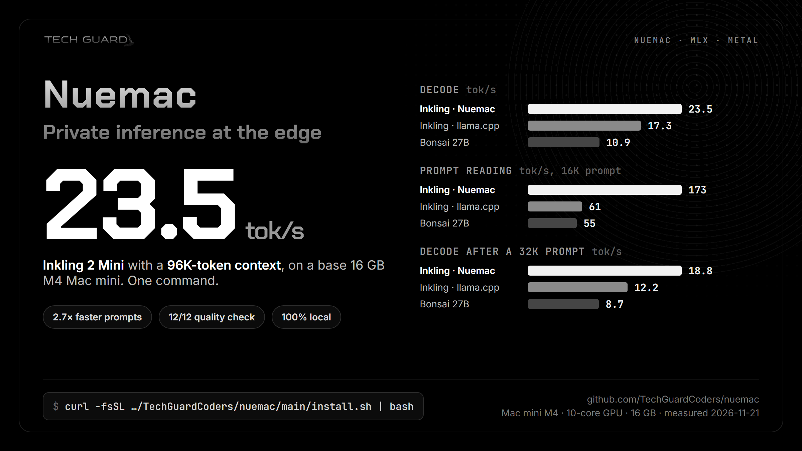

# Nuemac

**Private inference at the edge.**

<p align="center"></p>

Nuemac gives the Mac you already own a new life as a private AI machine. It's a local LLM engine for
memory-tight Apple Silicon: big open models with long contexts, on a 16 GB Mac mini, served as an
OpenAI-compatible API on your own machine. Prompts, documents and answers never leave it, and there's no
per-token bill.

Under the hood it runs on [MLX](https://github.com/ml-explore/mlx), with its own KV-cache layouts and Metal
kernels for each model family. One command installs it and a model, and one more benchmarks it on your Mac.

```bash
curl -fsSL https://raw.githubusercontent.com/TechGuardCoders/nuemac/main/install.sh | bash
```

Landing page: <https://techguardcoders.github.io/nuemac/>

## Supported models

| Model | Machine checked | Speed (base M4, 16 GB) | Recipe |
| --- | --- | --- | --- |
| **Inkling 2 Mini** (Thinking Machines), MLX oQ2.5e, 96K context | Mac mini M4, 16 GB | **23.5 tok/s** decode, 186 tok/s prefill, 18.8 tok/s at 32K | [inkling-2-mini](docs/recipes/inkling-2-mini.md) |

Pinned downloads, memory needs and limits: [docs/supported-models.md](docs/supported-models.md). How a model
gets here: [adding a family](docs/recipes/adding-a-family.md).

## Inkling 2 Mini on a 16 GB Mac mini

Same Mac, 96K context on every row, one model loaded, `nuemac bench --depth 32768`, server timings,
2026-11-21. The other two columns are the best builds we found on other engines, kept for comparison.

| | **Nuemac** | llama.cpp b12600 | Ternary Bonsai 2 27B (PrismML llama.cpp) |
| --- | --- | --- | --- |
| decode, short prompt | **23.5 tok/s** | 17.3 tok/s | 10.9 tok/s |
| prefill, 4K / 16K prompt | **186 / 173 tok/s** | 68 / 61 tok/s | 58 / 55 tok/s |
| 32K prompt: first token | **202 s** | 690 s | 647 s |
| 32K prompt: decode | **18.8 tok/s** | 12.2 tok/s | 8.7 tok/s |
| fact planted at 32K | found | found | found |
| 12 known-answer questions | 12/12 | 12/12 | 11/12 |

At a nearly full window (a 94K-token prompt) Nuemac answers after 11.8 minutes and decodes at 13.7 tok/s;
llama.cpp takes 42.6 minutes and decodes at 11.2. Raw results: [`results/`](results/). The llama.cpp and Bonsai setups install from
[inkling2-mini-mac-recipe](https://github.com/TechGuardCoders/inkling2-mini-mac-recipe), where this project
started.

What Nuemac does for this model (details and every experiment in the [recipe](docs/recipes/inkling-2-mini.md)):

1. **Window caches for the 40 sliding-window layer passes.** The stock MLX port kept full history on all 48
   passes (~192 KB per token) and fit ~7K tokens on 16 GB. Output is token-for-token identical.
2. **8-bit keys and values for the 8 global passes**, allocated once: 1.6 GB at 96K.
3. **A split-K Metal decode kernel** that reads that 8-bit cache directly: 20 ms per token at 96K, against
   73 ms for plain MLX ops.
4. **Fewer bytes per token.** The loop controllers stay bf16 instead of fp32 copies, and the output head runs
   at 6 bits (KL 0.0003 against 8-bit). Together: +5% decode.

## Requirements

- Apple Silicon Mac, 16 GB or more, macOS 14 or newer, ~14 GB free disk.
- [Homebrew](https://brew.sh). The installer adds [oMLX](https://github.com/jundot/omlx) from its tap for MLX,
  mlx-lm and the model code Nuemac runs on.
- On 16 GB, the GPU memory limit raised to 14.5 GB (macOS allows ~10.7 GB by default). The installer asks
  before running `sudo sysctl iogpu.wired_limit_mb=14500`, and can keep it after reboot.
- Close big apps while it runs. A Docker VM holding 10 GB will not leave room.

## What the installer does

It's a short script, so you can read [`install.sh`](install.sh) first. `--dry-run` prints the plan and stops.
It then:
1. Checks the Mac.
2. Installs oMLX (Homebrew) and Nuemac.
3. Downloads the model from Hugging Face at a pinned revision, checking each file's SHA-256. Downloads resume
   if interrupted.
4. Asks before raising the GPU limit.
5. Starts a login service on `127.0.0.1:8080` (loopback only).
6. Runs 12 known-answer questions, because a fast model that outputs garbage is the most common failure.

If you used the earlier `inkling2-mini-mac-recipe`, the installer reuses its verified model files and stops its
`mini-llm` service.

## Use it

```bash
curl http://127.0.0.1:8080/v1/chat/completions -H 'Content-Type: application/json' -d '{
  "model": "inkling-2-mini",
  "messages": [{"role": "user", "content": "Explain mixture-of-experts in two sentences."}]
}'
```

Any OpenAI-compatible client works with base URL `http://127.0.0.1:8080/v1`; the API key can be anything. The
server supports streaming, `reasoning_content`, tool calls and `reasoning_effort` (`low` / `medium` / `high`).
It also speaks llama-server's `/completion` with `timings`. It serves one request at a time and keeps the
conversation's cache, so a new turn only processes its new tokens.

| command | what it does |
| --- | --- |
| `nuemac status` | engine, model and server state |
| `nuemac models` | supported models and which are installed |
| `nuemac bench` | decode, prefill and the quality check (~10 min); `--depth 32768` adds a needle test |
| `nuemac stop` / `start` / `restart` / `logs` | the server |
| `nuemac uninstall` | remove the login service (files stay in `~/.nuemac`) |

## Repository

```
engine/server.py                 the engine: HTTP APIs, prefill/decode loop, multi-turn cache reuse
engine/families/inkling2/        Inkling 2: cache layout, Metal decode kernel (q8attn.py), weight trims
models/<model>.conf              pinned weights, file hashes, context, tested oMLX version
bin/nuemac, install.sh           CLI and installer
bench/                           the benchmark (curl + plutil, no Python)
docs/supported-models.md         what runs, on what, with which limits
docs/recipes/                    one page per model, plus how to add a family
results/                         raw benchmark JSON behind every number above
```

## Credits

Nuemac is a thin layer over other people's work. Full notices are in [NOTICE](NOTICE).

- [Thinking Machines Lab](https://huggingface.co/thinkingmachines/Inkling-2-Mini) for Inkling 2 Mini.
- [oMLX](https://github.com/jundot/omlx) for the MLX model code, chat handling and output parser.
  [MLX and mlx-lm](https://github.com/ml-explore) are by Apple.
- [mlx-community](https://huggingface.co/mlx-community/Inkling-2-Mini-oQ2.5e-mtp) for the MLX weights.
- [TensorFold](https://github.com/ashhart/TensorFold) for the engine-plus-recipes layout this repo follows, and
  [Strata](https://github.com/Niko1221/Strata) for kernel and dispatch ideas.
- Comparison builds: [llama.cpp](https://github.com/ggml-org/llama.cpp),
  [AtomicChat](https://huggingface.co/AtomicChat/Inkling-2-Mini-GGUF),
  [PrismML](https://huggingface.co/prism-ml/Ternary-Bonsai-2-27B-gguf).
- [Sybil Solutions](https://github.com/sybil-solutions/inference-optimisation-skill) for the tuning method.

## License

Apache-2.0 for Nuemac's engine, kernels, scripts and docs ([LICENSE](LICENSE)). Models and dependencies keep
their own licenses ([NOTICE](NOTICE)). Your numbers will differ: run `nuemac bench`.
